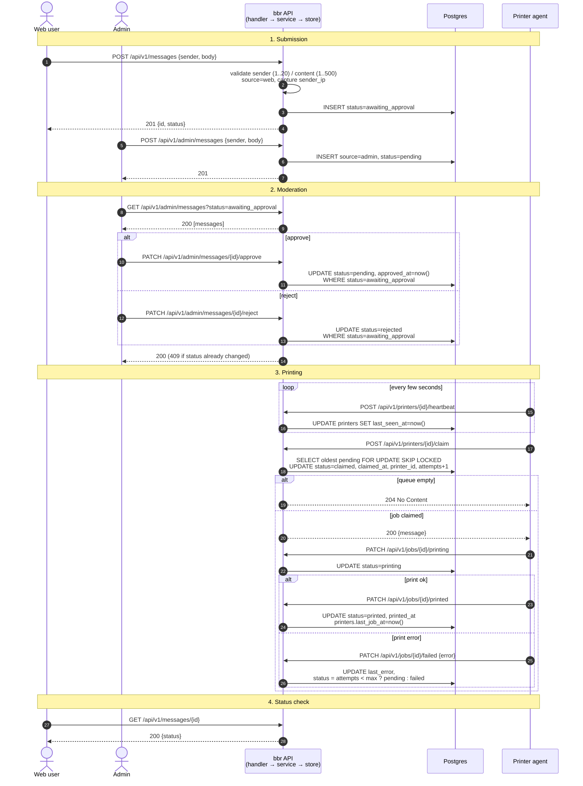
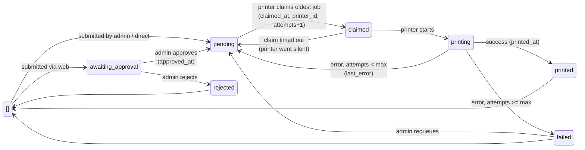
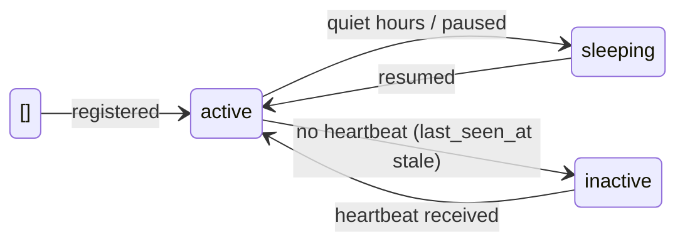

# Burn Before Reading
**Burn Before Reading** is a project to physically print messages left by people on a website. The short messages are submitted by vetted users via a simple website and handled by this Golang API. A Raspberry Pi does the interface with the printer. What makes this project stand out is that messages will be printed almost instantly by a *receipt thermal printer* at home.

> Thermal printers do not require any ink to print as they directly burn tiny dots on the paper

## High-level overview
Here are the main steps involved in submitting, processing, and, finally, printing a message:

1. The user authenticates on the website;
2. ... and submits a message.
3. The message is delivered to the server, via this API, which stores the message in a database and marks with the status `Pending` or `AwaitingApproval` depending on its source.
4. If the message has to be approved, a moderator performs some sanity checks on it.
5. The Raspberry Pi polls the server at regular intervals to check for `Pending` messages.
6. The Raspberry Pi claims the message and renders it according to the printer's specificities
7. The printer prints the message

## Message lifecycle

> These diagrams describe where the project is heading, not what is implemented today. Endpoint paths for the admin and printer APIs are provisional.

### Request flow



### Message states


### Printer states



Only `active` printers may claim jobs. A background reaper returns jobs stuck in `claimed` / `printing` on an `inactive` printer to `pending`.

## Development
### Dev database
The devcontainer's docker-compose.yml starts Postgres as the `db` service and runs migrations on boot. Don't run `docker compose` from inside the devcontainer.

`DATABASE_URL` is already set in the container:
> postgres://myuser:mypassword@db:5432/mydatabase?sslmode=disable

#### Apply / roll back migrations
```shell
migrate -path migrations -database "$DATABASE_URL" up
migrate -path migrations -database "$DATABASE_URL" down 1
```
#### Inspect the database
```shell
psql "$DATABASE_URL"
```
### Run the API
```shell
go run .
```

Then try submitting a message:
```shell
curl -s -X POST localhost:8080/api/v1/messages -H 'Content-Type: application/json' -d '{"sender":"Bob","body":"Hello!"}' | jq
```